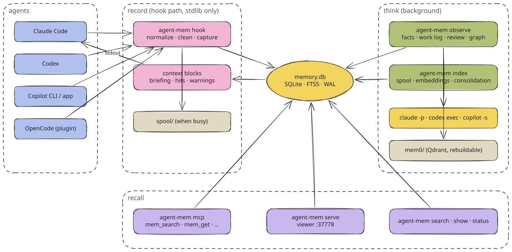

# agent-mem

One local memory for Claude Code, Codex, GitHub Copilot and OpenCode. No API key, no cloud, no telemetry.

The same pages as a website: [abuarchiv.github.io/agent-mem-docs](https://abuarchiv.github.io/agent-mem-docs/).

agent-mem records what your coding agents do, writes short facts from it in the background, and
reminds every agent of what matters at the right moment. Nothing leaves your computer. Everything sits in one
SQLite file, and you can browse it at `http://localhost:37778`.

## Quick start
1. Install the command (macOS, Linux, Windows):

   ```sh
   uv tool install "agent-mem[semantic,observer] @ git+https://github.com/Abuarchiv/agent-mem"
   ```

2. Connect every agent installed on this machine:

   ```sh
   agent-mem setup all --write
   ```

3. Check that it works:

   ```sh
   agent-mem doctor
   ```

4. Start a session in any repository and send one request. The next session begins with what the first one learned.
## What you get
- **A briefing at every start:** Facts, decisions, failed attempts, preferences and the last session's open steps, ranked by what has proven useful, within a token budget.
- **The right memory at the right moment:** Matching memories for a prompt, only when the match is strong. The history of a file before it is read or edited. How an error was fixed last time.
- **Corrections that stick:** Say "use pnpm instead of npm" twice and every agent is told before it runs `npm`. Switch the rule on and the command is blocked.
- **One memory for every agent:** What Claude Code learned is there for Codex, Copilot and OpenCode, and the other way round.
- **Facts without an API key:** The CLI you already pay for writes the facts in the background: Claude Haiku for Claude Code, GPT-6-Luna for Codex and Copilot, the free Big Pickle for OpenCode. A request never leaves its vendor.
- **Local and private:** No telemetry, no cloud, no server. Secrets are removed before storage; `<private>` text is never stored.
## How it works



<sub>[Excalidraw scene](assets/diagrams/system-overview.excalidraw)</sub>

| Moment | What happens |
| --- | --- |
| Session start | A briefing for the agent, a panel for you: project memory, which model writes facts, recent work, what needs your attention |
| You send a request | Matching memories, only when the match is strong; the terminal stays quiet |
| Before a command or edit | A note if it matches something you corrected, the file's history, or a block for a rule you switched on |
| A command fails | If this error was fixed before, the agent sees how |
| The agent finishes | The request is saved; a background process writes facts, a title, the session summary and lessons |
| Once a day | Duplicates and replaced facts are retired; your own notes are never touched |
| Compaction | Session goal, decisions and open problems are given back to the agent |
| Session end | What was saved: requests, files, errors |

Read [Architecture Overview](docs/architecture/overview.md) for the full picture.

## Supported

| | |
| --- | --- |
| Agents | Claude Code 2.x, Codex CLI 0.x, GitHub Copilot CLI 1.0.103, the Copilot app 1.1.29 (macOS), Copilot Chat in VS Code 1.142, OpenCode 1.19 and 2.2 |
| Python | 3.11 to 3.14 |
| OS | macOS (arm64; Intel without search by meaning), Linux, Windows |
| Install size | about 10 MB, plus 220 MB for search by meaning, plus about 400 MB for background facts |

> [!NOTE]
> agent-mem is not on PyPI. Install it from the repository, never by its bare name: a package registered there under
> that name would not be this one.

## Next steps
- [Installation](docs/getting-started/installation.md): Install options, sizes, what setup writes.
- [Your first session](docs/getting-started/first-session.md): What you see and what the agent gets.
- [Agents](docs/agents/claude-code.md): Claude Code, Codex, Copilot and OpenCode in detail.
- [Configuration](docs/configuration/config-json.md): Every setting with its default.

## Contents

**Get started**

- [Installation](docs/getting-started/installation.md): Install agent-mem, connect your agents, and check the result.
- [Your first session](docs/getting-started/first-session.md): What happens in the first and the second session, what you see and what the agent gets.
- [Upgrade & uninstall](docs/getting-started/upgrade-uninstall.md): Move to the newest version without a gap, or remove agent-mem cleanly.

**Agents**

- [Claude Code](docs/agents/claude-code.md): How agent-mem connects to Claude Code, what it shows there, and what to know.
- [Codex](docs/agents/codex.md): How agent-mem connects to the Codex CLI, the trust step, and what Codex shows.
- [Copilot CLI & app](docs/agents/copilot.md): How agent-mem connects to GitHub Copilot CLI and the Copilot app, and the Copilot-specific details.
- [OpenCode](docs/agents/opencode.md): The agent-mem plugin for OpenCode, what it maps, and what OpenCode does not get.

**Using agent-mem**

- [Session briefing](docs/using/briefing.md): What the agent gets at the start of every session, what you see, and how to make it bigger or smaller.
- [Reminders during work](docs/using/recall-during-work.md): What agent-mem tells the agent while it works: matching memories, rule notes, file history, fix hints.
- [Search & MCP tools](docs/using/search-and-mcp.md): How you and your agents search memory, and the five tools agents get.
- [Viewer](docs/using/viewer.md): The local page at localhost:37778. What each view shows and how to use it.
- [Rules & lessons](docs/using/rules-and-lessons.md): How corrections become rules that warn or block, and how mistakes become lessons for next time.
- [Privacy](docs/using/privacy.md): What agent-mem stores, what it never stores, and how to keep things out.
- [Pause, export, purge](docs/using/pause-export-purge.md): Stop recording for a while, take your memory with you, or delete it for good.

**Background facts**

- [How facts are written](docs/facts/how-facts-are-written.md): What happens after each request, what the background model writes, and how stale facts are cleaned up.
- [Providers & models](docs/facts/providers-and-models.md): Which CLI and model write facts for which agent, how to change it, and what it costs.

**Configuration**

- [config.json](docs/configuration/config-json.md): Every setting agent-mem reads, its default, its allowed range and what it changes.
- [.agent-mem.json](docs/configuration/project-settings.md): Per-project settings in the repository root. Only two harmless keys are honoured.
- [CLI](docs/configuration/cli.md): Every agent-mem command and option, with real output.
- [Environment variables](docs/configuration/environment.md): The variables agent-mem reads, and the agents' own variables it follows.

**Architecture**

- [Architecture Overview](docs/architecture/overview.md): The parts of agent-mem, how data flows through them, and where each piece lives in the code.
- [How agent-mem uses hooks](docs/architecture/hooks.md): A lifecycle-driven design. Every feature runs on an event the coding agent already fires.
- [Hook Lifecycle](docs/architecture/hook-lifecycle.md): Every stage of a session as agent-mem sees it, with payloads and outputs for each agent. A reference for adding another agent.
- [Background Processes](docs/architecture/background-processes.md): observe, index, serve and mcp. Who starts them, what they hold, how long they live, and the files they use.
- [Observer Pipeline](docs/architecture/observer-pipeline.md): How agent-mem observe turns finished requests into facts, a work log and lessons, using the agent's own CLI.
- [Database](docs/architecture/database.md): memory.db table by table, the FTS5 index, migrations, connection settings and what lives next to it in mem0/.
- [Search Architecture](docs/architecture/search.md): Hybrid retrieval over SQLite (FTS5, vectors, graph), the five MCP tools, and why agent-mem would rather say nothing than something weak.
- [Context Injection](docs/architecture/context-injection.md): Every block agent-mem gives an agent, when it gives it, how it is chosen, and the token budget it must fit.
- [Learning & Ranking](docs/architecture/learning-and-ranking.md): What agent-mem learns without a model call, how each signal is stored, and how it moves a memory up or down.
- [Capture & Privacy](docs/architecture/capture-and-privacy.md): What a hook stores from each event, what it never stores, how secrets are removed, and how a folder becomes a project.
- [Token Accounting](docs/architecture/token-accounting.md): How agent-mem measures what finding something out cost the agent, and what the "savings" line does and does not claim.

**Reference**

- [Troubleshooting](docs/troubleshooting.md): Every message agent-mem can show, what causes it, and what to do.
- [Measurements](docs/measurements.md): Hook latency, retrieval quality on LongMemEval-S and on the repository's fixture, and how to run them yourself.
- [Development](docs/development.md): Working on agent-mem itself, and working on these docs.
