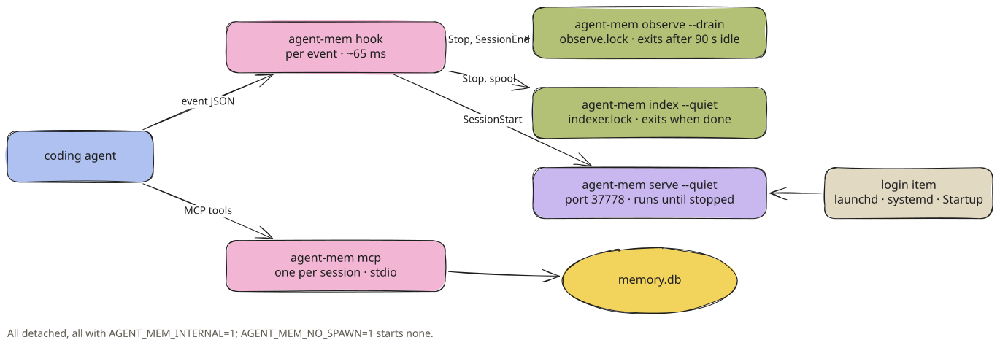

# Background Processes

observe, index, serve and mcp. Who starts them, what they hold, how long they live, and the files they use.

agent-mem has no daemon to install and no service to keep alive. The hook starts short-lived background
processes when there is work. One small web server, the viewer, stays up so the page is reachable.



<sub>[Excalidraw scene](../../assets/diagrams/processes.excalidraw)</sub>

| Process | Started by | Lifetime | Guard | Priority |
| --- | --- | --- | --- | --- |
| `agent-mem hook <harness>` | the agent, per event | ~65 ms | 400 ms deadline | normal |
| `agent-mem mcp` | the agent, per session | the session | one SQLite connection, calls serialized | normal |
| `agent-mem observe --drain --quiet` | `Stop`, `SessionEnd`, the indexer | until 90 s without work | `observe.lock`, 15 s spawn throttle | `nice 10` |
| `agent-mem index --quiet` | `Stop`, `SessionEnd`, a waiting spool, a pending migration | until its work is done | `indexer.lock`, 60 s spawn throttle | normal |
| `agent-mem serve --quiet` | `SessionStart` when the port is silent; the login item | until stopped | the port | background |

Every process agent-mem starts is detached from the agent (`start_new_session`, or `DETACHED_PROCESS |
CREATE_NEW_PROCESS_GROUP | CREATE_NO_WINDOW` on Windows), has stdin, stdout and stderr closed, and runs with
`AGENT_MEM_INTERNAL=1` and `AGENT_MEM_DATA_DIR` set. Its own work is never recorded, and it uses the same data
folder as the hook that started it. `AGENT_MEM_NO_SPAWN=1` stops the hook from starting anything.

## agent-mem observe

The observer turns finished requests into facts with the agent's own CLI. All details are on
[Observer Pipeline](observer-pipeline.md).

```text
$ agent-mem observe --status
Requests: 42 waiting, 0 with facts, 0 saved word for word, 0 failed
```

| Option | Does |
| --- | --- |
| *(none)* | one pass over what is due, then review and graph |
| `--drain` | loop until nothing was due for `observe.idle_seconds` (what the hook starts) |
| `--once` | process what is due and exit without waiting |
| `--status` | queue counts, last errors, today's calls per provider and purpose (`--json` for all) |
| `--retry-failed` | `failed` turns back to `pending` with zero attempts, then a pass |
| `--reprocess-raw` | turns stored word for word go back to the queue (after installing a CLI) |
| `--reindex` | rebuild Qdrant, the entity store and `history.db` from SQLite, no model call |
| `--quiet` | no output |

A second observer while one runs returns at once: `skipped: locked`.

## agent-mem index

The indexer does everything the hook leaves for later, in this order:

| # | Step | Note |
| --- | --- | --- |
| 1 | integrity check | read-only `PRAGMA quick_check`; a damaged file is moved aside as `memory.db.corrupt-<time>` |
| 2 | migrations | when the schema is behind; all in one exclusive transaction |
| 3 | spool replay | in file-name order (nanosecond time first); a record that can never apply goes to `quarantine/` |
| 4 | stale turns | open turns without activity for `retention.stale_turn_minutes` are closed as `unknown` |
| 5 | token accounting | `turns.work_tokens` from the agents' transcripts ([Token Accounting](token-accounting.md)) |
| 6 | native notes | Claude Code `memory/*.md`, Codex rollout summaries ([below](#native-notes)) |
| 7 | retired keys | search keys and vectors of retired memories are removed |
| 8 | project aliases | a project first seen before its first commit or remote stays the same project |
| 9 | guards file | `guards.json`: whether any rule exists and which files have history, so `PreToolUse` can skip the database |
| 10 | embeddings | up to 512 new turns and memories (all of them after a model change); duplicate facts merged |
| 11 | consolidation | once per 24 h ([Learning & Ranking](learning-and-ranking.md#daily-consolidation)) |
| 12 | retention | payload trimming, access and call log cleanup, `VACUUM` above `retention.max_db_mb` |
| 13 | spool again | up to 5 more passes for events that arrived meanwhile |
| 14 | observer | started if the replay or stale turns queued work |
| 15 | `PRAGMA optimize`, WAL checkpoint (passive) | |

`agent-mem index` runs it by hand. `--no-download` skips fetching the search model, `--json` prints the stats. A
second indexer returns `skipped: another indexer is running`. A database held by another process longer than 5 s
is not an error; the run stops and the spool waits for the next one.

### The spool

Events that cannot reach the database right now wait in `spool/`, one small JSON file each:

```text
spool/01760385174362715000-12734-3c8297d3e1a0-9f2b1c4d.json
       └ time in ns ────────┘ └pid┘ └ session tag ┘ └ random ┘
```

Each file is written to a hidden temp name, flushed, `fsync`ed and renamed into place, so the indexer never reads
half a file. The session tag (first 12 hex of the SHA-256 of `harness:session_id`) lets a hook see that an earlier
event of its session is still waiting, and queue behind it. Replay applies each record through the same
`capture.apply` as a live hook, without producing context. It is idempotent, because every event has a unique
dedupe key.

| Situation | Hook | Indexer |
| --- | --- | --- |
| database locked for a moment | spools, starts the indexer (5 s throttle when its session waits) | replays in order |
| events wait longer than 30 s | says so in the terminal: `agent-mem cannot save events: they wait in the spool` | — |
| more than 1,000 waiting | the briefing carries `! agent-mem: N events waiting in spool` | — |
| a record cannot be parsed or never applies | — | moved to `quarantine/` |

### Native notes

Claude Code and Codex keep notes of their own. The indexer reads them as memories, without a model call:

| Agent | Source | Stored as |
| --- | --- | --- |
| Claude Code | `~/.claude/projects/<folder>/memory/*.md` (one fact per file, front matter `name`, `description`, `type`) | `kind = native_note`, `origin = claude-auto-memory` |
| Codex | `~/.codex/memories/rollout_summaries/*` (one summary per session) | `kind = native_note`, `origin = codex-memory` |

- Each agent already loads its own notes, so a note is shown **only to the other agents**. Codex learns what
  Claude Code noted, and the other way round.
- The project comes from the transcript next to the memory folder, because Claude Code's folder name cannot be
  turned back into a path.
- A changed note replaces the stored one (the old version stays, superseded). A deleted Claude Code note is
  retired; a deleted Codex summary stays, because Codex prunes those by age, not because they were wrong.
- Symlinks, hidden files and files over 64 KB are skipped. Source files are never written. Files are read before
  the write lock is taken.
- `"native_notes": false` in `config.json` turns this off.

## agent-mem serve

The viewer at `http://localhost:37778/`. See [Viewer](../using/viewer.md) for what it shows.

| Property | Value |
| --- | --- |
| Bind | `127.0.0.1` only; `viewer.port` (37778) |
| Routes | `GET /` (the page, `?project=<id>` for one project), `GET /health` (`agent-mem 1.0.0`, plain text); anything else 404 |
| Host check | a request whose `Host` is not `localhost:<port>` or `127.0.0.1:<port>` gets 403: protection against DNS rebinding |
| Headers | `Cache-Control: no-store`, `X-Content-Type-Options: nosniff`, `Referrer-Policy: no-referrer`, `Content-Security-Policy: frame-ancestors 'none'`; the page itself allows its own script by hash and no network |
| Page | built per request, cached until the database changes (WAL or file size and time), at most a minute; an open tab reloads every `viewer.refresh_seconds` (10) |
| Upgrade | when the installed package changed, the next request gets "agent-mem was updated" and the process exits with code 75, so launchd or systemd restarts it on the new code |
| Errors | an unreadable database gives a page that says so and retries every 10 s |
| Port in use | `Cannot start the viewer on 127.0.0.1:37778: …; set "viewer": {"port": <free port>}` (exit 1), unless an agent-mem viewer already answers there |

### Starting at login

`agent-mem setup … --write` and `agent-mem serve --autostart` register a login item, so the page is reachable after
a restart without starting an agent first. `agent-mem serve --no-autostart` removes it.

| OS | Item | Behaviour |
| --- | --- | --- |
| macOS | `~/Library/LaunchAgents/io.github.abuarchiv.agent-mem.viewer.plist` | `RunAtLoad`, `KeepAlive` only after a failed exit, `ThrottleInterval` 10 s; started with `launchctl bootstrap gui/<uid>`; deletes itself and boots out if the interpreter is gone |
| Linux | `~/.config/systemd/user/agent-mem-viewer.service` | `Restart=on-failure`, `RestartSec=10`, `ConditionPathExists=<python>`; `systemctl --user enable --now` |
| Windows | `%APPDATA%\Microsoft\Windows\Start Menu\Programs\Startup\agent-mem-viewer.cmd` | starts `pythonw.exe` (no console window) at login; deletes itself if the interpreter is gone |
| Linux without systemd | none | `viewer autostart: no systemd on this machine; add agent-mem serve --quiet to your login items.` |

The item carries `AGENT_MEM_DATA_DIR`, `AGENT_MEM_INTERNAL=1` and the `PATH` from setup. Login items start with a
bare `PATH`, and the Health page looks up `claude`, `codex` and `copilot` on it.

`"viewer": {"enabled": false}` turns the viewer off; the hooks then never start it.

## agent-mem mcp

The MCP server, one stdio process per agent session. The agent starts it from its MCP configuration; it answers
`mem_search`, `mem_timeline`, `mem_get`, `mem_remember` and `mem_forget`. See
[Search Architecture](search.md#the-five-mcp-tools). It holds one SQLite connection with a 2 s busy
timeout and runs one tool call at a time on it. Search never opens a write transaction.

## Files in the data folder

```text
~/Library/Application Support/agent-mem/      (agent-mem paths)
├── memory.db                  the database (0600)
├── memory.db-wal, -shm        SQLite write-ahead log
├── memory.db.corrupt-<time>   only after a failed integrity check, with its -wal and -shm
├── config.json                settings (agent-mem paths: Settings)
├── guards.json                what PreToolUse must check (rules exist, files with history)
├── observe.lock               held by the running observer
├── indexer.lock               held by the running indexer
├── .observer-spawned          15 s throttle for starting the observer
├── .migration-requested       60 s throttle for starting the indexer outside the database
├── .last-notice               the last terminal notice and when (10 min repeat guard)
├── logs/
│   ├── hook.log               one JSON line per hook problem
│   └── observe.log            one JSON line per observer run or failure
├── spool/                     events waiting for the database
├── quarantine/                records that could not be read or applied (deleted after 30 days)
├── models/                    search model and the spaCy topic model
└── mem0/                      Qdrant (local), entity store, history.db
```

> [!NOTE]
> Logs never contain prompt text. `hook.log` names harness, event and error; `observe.log` has the run's counts or
> the error class.

## Upgrading while sessions run

`agent-mem upgrade` swaps the installed environment in place (`uv tool install --upgrade`), so hooks firing during
the upgrade still find a binary. Then `agent-mem doctor --fix` migrates the database and rewrites hooks an older
release wrote. Running sessions keep working:

- a hook that meets a database still on the old schema spools its event and starts the indexer, which migrates and
  replays;
- the viewer notices the new code on its next request, answers "agent-mem was updated" and restarts;
- an MCP server keeps its connection; a database written by a newer schema answers with an error sentence
  until the agent restarts the server.

Avoid `uv tool install --reinstall`. It deletes the environment first, and hooks firing in those seconds find no
binary.

---

← [Hook Lifecycle](hook-lifecycle.md) · [Contents](../../README.md#contents) · [Observer Pipeline](observer-pipeline.md) →
