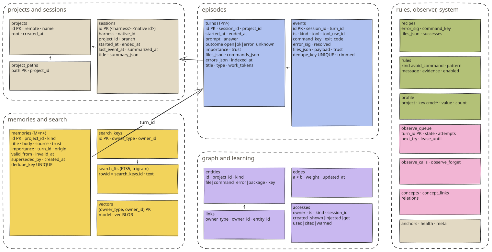

# Database

memory.db table by table, the FTS5 index, migrations, connection settings and what lives next to it in mem0/.

SQLite is the truth. Everything agent-mem knows is in one file, `memory.db`; everything in `mem0/` can be rebuilt
from it without a model call.

## Location

| OS | Data folder |
| --- | --- |
| macOS | `~/Library/Application Support/agent-mem/` |
| Linux | `$XDG_DATA_HOME/agent-mem/`, else `~/.local/share/agent-mem/` |
| Windows | `%LOCALAPPDATA%\agent-mem\` |

`AGENT_MEM_DATA_DIR` overrides it, and `agent-mem paths` prints it. The folder is `0700` and the database `0600` on
macOS and Linux.

## Connection

```sql
PRAGMA busy_timeout = 150;          -- hooks; the MCP server 2,000; indexer 5,000; observer 10,000
PRAGMA foreign_keys = ON;
PRAGMA journal_mode = WAL;          -- readers never wait for a writer
PRAGMA synchronous = NORMAL;
PRAGMA journal_size_limit = 4194304; -- the WAL shrinks back to 4 MB after a large write
```

Writes run in `BEGIN IMMEDIATE` transactions, so two writers queue at the start rather than fail at commit. A hook
waits at most 150 ms for the write lock. After that the event goes to the spool, well inside the 400 ms deadline.
Claude Code, Codex, Copilot and OpenCode can run at the same time in the same project; their writes are
serialized by SQLite.

## Tables



<sub>core/schema/001_init.sql … 008_events_session.sql · [Excalidraw scene](../../assets/diagrams/er.excalidraw)</sub>

Owners are addressed as `(owner_type, owner_id)`: `'t'` is a turn, `'m'` a memory. Everything visible uses that
as `T12` and `M3`.

### projects, project_paths

```sql
CREATE TABLE projects (
  id TEXT PRIMARY KEY,            -- first 16 hex of sha256(remote | root commit | path)
  remote TEXT,                    -- normalized: github.com/me/app
  name TEXT NOT NULL,
  root TEXT NOT NULL,
  created_at TEXT NOT NULL
);
CREATE TABLE project_paths (
  path TEXT PRIMARY KEY,          -- every folder seen, so git is asked only once
  project_id TEXT NOT NULL REFERENCES projects(id) ON DELETE CASCADE
);
```

See [Capture & Privacy](capture-and-privacy.md#how-a-folder-becomes-a-project).

### sessions

```sql
CREATE TABLE sessions (
  id TEXT PRIMARY KEY,            -- '<harness>:<native session id>'
  harness TEXT NOT NULL,          -- claude | codex | copilot | opencode
  native_id TEXT NOT NULL,
  project_id TEXT REFERENCES projects(id) ON DELETE CASCADE,
  branch TEXT,
  started_at TEXT NOT NULL,
  ended_at TEXT,
  last_event_at TEXT NOT NULL,
  summarized_at TEXT,
  title TEXT,                     -- v3: the observer's session title
  summary_json TEXT               -- v3: {"learned": [...], "completed": [...], "next_steps": [...]}
);
CREATE INDEX sessions_project ON sessions(project_id, last_event_at);
```

### turns

One request and everything done for it, from the prompt to the answer.

```sql
CREATE TABLE turns (
  id INTEGER PRIMARY KEY,
  session_id TEXT NOT NULL REFERENCES sessions(id) ON DELETE CASCADE,
  project_id TEXT REFERENCES projects(id) ON DELETE CASCADE,
  started_at TEXT NOT NULL,
  ended_at TEXT,
  prompt TEXT NOT NULL DEFAULT '',
  answer TEXT NOT NULL DEFAULT '',
  outcome TEXT NOT NULL DEFAULT 'open' CHECK (outcome IN ('open', 'ok', 'error', 'unknown')),
  importance REAL NOT NULL DEFAULT 0.1,
  trust TEXT NOT NULL DEFAULT 'user',
  files_json TEXT NOT NULL DEFAULT '[]',      -- read and edited, relative to the project, up to 40
  commands_json TEXT NOT NULL DEFAULT '[]',   -- up to 40
  errors_json TEXT NOT NULL DEFAULT '[]',     -- first error lines, up to 10
  indexed_at TEXT,
  title TEXT,                                  -- v3: ≤ 80 characters, by the observer
  type TEXT,                                   -- v3: bugfix | feature | change | discovery | decision | question
  work_tokens INTEGER                          -- v6: tokens the agent spent, from its transcript
);
CREATE INDEX turns_session ON turns(session_id, id);
CREATE INDEX turns_project ON turns(project_id, started_at);
CREATE INDEX turns_open ON turns(outcome, started_at);
```

### events

Every hook call that passed the checks, once.

```sql
CREATE TABLE events (
  id INTEGER PRIMARY KEY,
  session_id TEXT NOT NULL REFERENCES sessions(id) ON DELETE CASCADE,
  turn_id INTEGER REFERENCES turns(id) ON DELETE CASCADE,
  ts TEXT NOT NULL,
  kind TEXT NOT NULL,             -- session_start | prompt | pre_tool | tool | stop | subagent_stop | compact | session_end
  tool TEXT,
  tool_use_id TEXT,
  command_key TEXT,               -- 'uv run pytest'
  exit_code INTEGER,
  error_sig TEXT,
  resolved INTEGER NOT NULL DEFAULT 0,
  files_json TEXT NOT NULL DEFAULT '[]',
  payload TEXT NOT NULL,          -- JSON, cleaned; trimmed after retention.payload_days
  trust TEXT NOT NULL,            -- user | tool_local | tool_external
  dedupe_key TEXT NOT NULL UNIQUE,
  trimmed INTEGER NOT NULL DEFAULT 0
);
CREATE INDEX events_turn ON events(turn_id);
CREATE INDEX events_session_failures ON events(session_id, command_key, resolved) WHERE error_sig IS NOT NULL;
CREATE INDEX events_ts ON events(ts);
CREATE INDEX events_session_ts ON events(session_id, ts);   -- v8
```

`events_session_ts` exists for one query on the hook path: finding the session's edits since a failure when the
command passes again. Without it, that query read the events of every session in the time window.

### memories

Append-only knowledge: facts, decisions, rules, lessons, notes.

```sql
CREATE TABLE memories (
  id INTEGER PRIMARY KEY,
  project_id TEXT REFERENCES projects(id) ON DELETE CASCADE,   -- NULL = global
  kind TEXT NOT NULL CHECK (kind IN (
    'summary', 'fact', 'decision', 'dead_end', 'preference', 'correction', 'lesson', 'native_note'
  )),
  title TEXT NOT NULL,            -- ≤ 300
  body TEXT NOT NULL,             -- ≤ 8,000
  source TEXT NOT NULL CHECK (source IN ('hook', 'agent', 'native', 'harness_summary', 'import')),
  trust TEXT NOT NULL,            -- user | agent | observer | raw
  importance REAL NOT NULL DEFAULT 0.5,
  turn_id INTEGER REFERENCES turns(id) ON DELETE SET NULL,
  origin TEXT,                    -- the harness, or claude-auto-memory / codex-memory for native notes
  valid_from TEXT NOT NULL,
  invalid_at TEXT,                -- set when retired; the row stays
  superseded_by INTEGER REFERENCES memories(id) ON DELETE SET NULL,
  created_at TEXT NOT NULL,
  dedupe_key TEXT UNIQUE
);
CREATE INDEX memories_project ON memories(project_id, kind, invalid_at);
CREATE INDEX memories_turn ON memories(turn_id);   -- v6
```

| kind | Written by | source / trust |
| --- | --- | --- |
| `fact`, `decision`, `dead_end` | observer extraction | `agent` / `observer` |
| `preference` | observer `[rule]`; two corrections of the same rule | `agent` / `observer`; `hook` / `user` |
| `lesson` | observer work log | `agent` / `observer` |
| `correction`, `decision` | prompt hook without a working observer | `hook` / `user` |
| `dead_end` | a revert after edits | `hook` / `agent` |
| `fact`, `decision`, `dead_end`, `lesson` | `mem_remember` | `agent` / `agent` |
| `summary` | a turn no model could take | `hook` / `raw` |
| `native_note` | Claude Code `memory/*.md`, Codex rollout summaries | `native` / `agent` |

| dedupe_key | Meaning |
| --- | --- |
| `mem0:<id>` | mirrored from mem0 |
| `lesson:<sha256>` | lesson text, normalized |
| `pref\|<project>\|<avoid>\|<count>` | preference from corrections |
| `global-pref\|<text>\|<id>` | preference promoted to all projects |
| `raw:<first>-<last>` | turns stored word for word |
| `note:<source>:<hash>` | a native note version |
| otherwise | sha256 of project, kind, title and body |

Retiring a memory (`store.supersede`) sets `invalid_at` and `superseded_by`, removes its search keys and vector,
and queues its mem0 copy for removal. Search never returns it; `agent-mem show` and the viewer still do.

### search_keys, search_fts

```sql
CREATE TABLE search_keys (
  id INTEGER PRIMARY KEY,
  owner_type TEXT NOT NULL,
  owner_id INTEGER NOT NULL
);
CREATE INDEX search_keys_owner ON search_keys(owner_type, owner_id);

CREATE VIRTUAL TABLE search_fts USING fts5(text, tokenize = 'trigram');
```

One owner can have several keys: its own text plus `related: <title>` keys added by consolidation. A turn's key is
`[<harness> · <branch> · <day>]`, prompt, answer, `files:` (paths and file names), `commands:` and `errors:`; a
memory's is `<kind>: <title>` and its body; each is capped at 12,000 characters. The **trigram** tokenizer makes
every substring of three or more characters searchable, in any language, so a stem matches all its forms. Queries
quote every term and double embedded `"`; FTS syntax from a user cannot get through.

### vectors

```sql
CREATE TABLE vectors (
  owner_type TEXT NOT NULL,
  owner_id INTEGER NOT NULL,
  model TEXT NOT NULL,            -- the embedder that made it
  vec BLOB NOT NULL,              -- float32, normalized
  PRIMARY KEY (owner_type, owner_id)
);
```

One vector per owner, upserted. Changing `semantic.model` re-embeds everything on the next indexer run (up to
100,000 at once instead of 512).

### entities, links, edges

```sql
CREATE TABLE entities (
  id INTEGER PRIMARY KEY,
  project_id TEXT,
  kind TEXT NOT NULL CHECK (kind IN ('file', 'command', 'error', 'package')),
  key TEXT NOT NULL,              -- 'calc.py', 'uv run pytest', 'sig:7c57…', 'left-pad'
  UNIQUE (project_id, kind, key)
);
CREATE TABLE links (
  owner_type TEXT NOT NULL, owner_id INTEGER NOT NULL,
  entity_id INTEGER NOT NULL REFERENCES entities(id) ON DELETE CASCADE,
  PRIMARY KEY (owner_type, owner_id, entity_id)
);
CREATE INDEX links_entity_owner ON links(entity_id, owner_id);
CREATE TABLE edges (
  a INTEGER NOT NULL REFERENCES entities(id) ON DELETE CASCADE,
  b INTEGER NOT NULL REFERENCES entities(id) ON DELETE CASCADE,
  weight REAL NOT NULL,           -- Hebbian, 0..1
  updated_at TEXT NOT NULL,
  PRIMARY KEY (a, b),
  CHECK (a < b)
);
CREATE INDEX edges_b ON edges(b);
```

### anchors

```sql
CREATE TABLE anchors (
  owner_type TEXT NOT NULL, owner_id INTEGER NOT NULL,
  path TEXT NOT NULL,
  blob_hash TEXT,                 -- git hash-object of the file when recorded
  recorded_at TEXT NOT NULL,
  PRIMARY KEY (owner_type, owner_id, path)
);
```

Consolidation records the blob hash of each linked file (up to 2,000 per run). `mem_get` compares it with the
file now: `unchanged`, `changed since <day>` or `deleted`. A dead end or decision whose every anchored file was
deleted is retired.

### accesses

```sql
CREATE TABLE accesses (
  id INTEGER PRIMARY KEY,
  owner_type TEXT NOT NULL, owner_id INTEGER NOT NULL,
  ts TEXT NOT NULL,
  kind TEXT NOT NULL CHECK (kind IN ('created', 'shown', 'injected', 'get', 'used', 'cited', 'warned')),
  session_id TEXT
);
CREATE INDEX accesses_owner ON accesses(owner_type, owner_id, ts);
CREATE INDEX accesses_session ON accesses(session_id, kind, ts);
```

The basis of activation and usefulness, see [Learning & Ranking](learning-and-ranking.md).

### recipes, rules, profile

```sql
CREATE TABLE recipes (
  id INTEGER PRIMARY KEY,
  project_id TEXT REFERENCES projects(id) ON DELETE CASCADE,
  error_sig TEXT NOT NULL, error_text TEXT NOT NULL, command_key TEXT NOT NULL,
  files_json TEXT NOT NULL,                       -- files changed between failure and pass
  successes INTEGER NOT NULL DEFAULT 1,
  recurrences INTEGER NOT NULL DEFAULT 0,
  last_turn_id INTEGER,
  updated_at TEXT NOT NULL,
  UNIQUE (project_id, error_sig, command_key)
);
CREATE TABLE rules (
  id INTEGER PRIMARY KEY,                         -- R<n>
  project_id TEXT REFERENCES projects(id) ON DELETE CASCADE,
  kind TEXT NOT NULL CHECK (kind IN ('avoid_command')),
  pattern TEXT NOT NULL,                          -- the program to avoid: 'npm'
  message TEXT NOT NULL,                          -- 'Use `pnpm` instead of `npm`'
  evidence INTEGER NOT NULL DEFAULT 1,            -- corrections that stated it
  enabled INTEGER NOT NULL DEFAULT 0,             -- 1 = deny the tool call
  hits INTEGER NOT NULL DEFAULT 0,
  overrides INTEGER NOT NULL DEFAULT 0,
  created_at TEXT NOT NULL, last_hit_at TEXT,
  UNIQUE (project_id, kind, pattern)
);
CREATE TABLE profile (
  project_id TEXT NOT NULL REFERENCES projects(id) ON DELETE CASCADE,
  key TEXT NOT NULL,                              -- cmd:test | cmd:build | cmd:lint | cmd:install
  value TEXT NOT NULL,                            -- 'uv run pytest -q'
  count INTEGER NOT NULL DEFAULT 1,
  updated_at TEXT NOT NULL,
  PRIMARY KEY (project_id, key, value)
);
```

### observe_queue, observe_calls, observe_forget

```sql
CREATE TABLE observe_queue (
  turn_id INTEGER PRIMARY KEY REFERENCES turns(id) ON DELETE CASCADE,
  state TEXT NOT NULL DEFAULT 'pending' CHECK (state IN ('pending', 'running', 'done', 'raw', 'failed')),
  attempts INTEGER NOT NULL DEFAULT 0,
  next_try TEXT NOT NULL,
  lease_until TEXT,
  provider TEXT,                  -- the stage that took it
  last_error TEXT,
  updated_at TEXT NOT NULL
);
CREATE INDEX observe_queue_state ON observe_queue(state, next_try);

CREATE TABLE observe_calls (      -- every model call; never the prompt text
  id INTEGER PRIMARY KEY,
  ts TEXT NOT NULL,
  provider TEXT NOT NULL,
  purpose TEXT NOT NULL CHECK (purpose IN ('extract', 'judge', 'summary', 'review', 'graph')),
  seconds REAL NOT NULL, ok INTEGER NOT NULL, prompt_chars INTEGER NOT NULL,
  turn_ids TEXT NOT NULL, error TEXT
);
CREATE INDEX observe_calls_ts ON observe_calls(ts);

CREATE TABLE observe_forget (     -- mem0 ids whose copy still has to go
  mem0_id TEXT PRIMARY KEY,
  ts TEXT NOT NULL
);
```

The hook path and the MCP server never import mem0. They leave an id in `observe_forget`, and the next observer
run deletes it from Qdrant, the entity store and `history.db`.

### concepts, concept_links, relations

```sql
CREATE TABLE concepts (
  id INTEGER PRIMARY KEY,
  project_id TEXT NOT NULL,
  key TEXT NOT NULL,              -- 'inject.py' for inject.py, `inject.py`, src/…/inject.py, Inject.py
  label TEXT NOT NULL,
  type TEXT NOT NULL,             -- file | function | module | tool | library | command | setting | error | service | concept
  specific INTEGER NOT NULL DEFAULT 1,
  UNIQUE (project_id, key)
);
CREATE TABLE concept_links (
  concept_id INTEGER NOT NULL REFERENCES concepts(id) ON DELETE CASCADE,
  memory_id INTEGER NOT NULL REFERENCES memories(id) ON DELETE CASCADE,
  PRIMARY KEY (concept_id, memory_id)
);
CREATE TABLE relations (
  id INTEGER PRIMARY KEY,
  project_id TEXT NOT NULL,
  source_id INTEGER NOT NULL REFERENCES concepts(id) ON DELETE CASCADE,
  target_id INTEGER NOT NULL REFERENCES concepts(id) ON DELETE CASCADE,
  type TEXT NOT NULL,             -- uses | calls | imports | reads | writes | stores_in | configures | depends_on | …
  memory_id INTEGER NOT NULL REFERENCES memories(id) ON DELETE CASCADE,
  UNIQUE (source_id, target_id, type, memory_id)
);
```

The viewer's Graph page. A concept no memory names any more is deleted with its last memory.

### health, meta

```sql
CREATE TABLE health (
  component TEXT PRIMARY KEY,     -- hook:claude | hook:codex | hook:copilot | hook:opencode | indexer | semantic | observer | consolidation
  last_ok_at TEXT, last_error_at TEXT, last_error TEXT,
  ok_count INTEGER NOT NULL DEFAULT 0, error_count INTEGER NOT NULL DEFAULT 0
);
CREATE TABLE meta (key TEXT PRIMARY KEY, value TEXT NOT NULL);
```

A component is failing when `last_error_at` is newer than `last_ok_at`. Its message then appears at session start
and in `doctor`.

| meta key | Holds |
| --- | --- |
| `paused_until` | ISO time or `forever` (`agent-mem pause`) |
| `indexer_spawned_at` | throttle for starting the indexer |
| `consolidated_at`, `vacuumed_at` | last consolidation, last `VACUUM` |
| `semantic` | the embedder in use, or `unavailable` |
| `duplicates.last_memory_id` | where the duplicate merge continues |
| `observe.embedder` | embedder of the mem0 index; a change triggers a rebuild |
| `observe.pause.<provider>`, `observe.pause_kind.<provider>` | a paused stage and why (`quota`, `login`) |
| `observe.graph_hold` | graph batches paused until |
| `observe.scrub_messages` | `1` after a turn was deleted: clear mem0's message history |
| `reviewed_at:<project>`, `review_cursor:<project>` | daily review time and its rotating slice |
| `graph.last:<project>` | where the graph reading continues |
| `injected:<day>` | blocks, tokens and measured work injected that day |
| `work.offset:<transcript>` | how far a transcript has been read for token accounting |
| `rule.turn\|<project>\|<avoid>\|<prefer>\|<turn>` | one statement counted once |

## Migrations

`PRAGMA user_version` holds the schema version. Migrations are the numbered files in `core/schema/`:

| Version | File | Change |
| --- | --- | --- |
| 1 | `001_init.sql` | base schema |
| 2 | `002_observe.sql` | `observe_queue`, `observe_calls`, `observe_forget` |
| 3 | `003_summaries.sql` | `turns.title`, `turns.type`, `sessions.title`, `sessions.summary_json` |
| 4 | `004_observe_purposes.sql` | `observe_calls.purpose` allows `summary`, `review` (table copied: SQLite cannot change a CHECK) |
| 5 | `005_concepts.sql` | `concepts`, `concept_links` |
| 6 | `006_work_tokens.sql` | `turns.work_tokens`, index `memories_turn` |
| 7 | `007_relations.sql` | `relations`; old spaCy concepts cleared; purpose `graph` |
| 8 | `008_events_session.sql` | index `events_session_ts` |

All pending migrations run in **one** `BEGIN EXCLUSIVE` transaction and either all apply or none. `ADD COLUMN`
for a column that already exists is skipped. **The hook path never migrates an existing database**: a migration
of a large file could outlast its deadline. It raises `MigrationPendingError`, spools the event and starts the
indexer, which migrates and then replays the spool. A database written by a newer release raises
`SchemaTooNewError` instead of being touched.

## Integrity and recovery

Each indexer run first opens the database **read-only** and runs `PRAGMA quick_check`. Read-only matters: a
writable connection checkpoints and deletes the WAL when it closes, even on a damaged file. A locked or busy
database is not damage. If the check fails, `memory.db`, `-wal` and `-shm` are moved aside as
`memory.db.corrupt-<time>` and a fresh database starts. The WAL holds committed writes and is kept for a manual
rescue; nothing is deleted.

> [!WARNING]
> The damaged copy stays next to the new database until you remove it. `agent-mem doctor` reports both.

## Retention

| What | When | Key |
| --- | --- | --- |
| event payloads trimmed to `raw_kind`, `category`, `error_line`, `trust` | after 30 days | `retention.payload_days` |
| `shown`, `warned`, `injected` accesses deleted | after 180 days | `retention.access_days` |
| `observe_calls` rows deleted | after 180 days | `retention.access_days` |
| quarantine notes deleted | after 30 days | `retention.payload_days` |
| the 5,000 oldest untrimmed payloads trimmed, then `VACUUM` | above 1,024 MB, at most once a day | `retention.max_db_mb` |
| open turns closed as `unknown` | 30 minutes without activity | `retention.stale_turn_minutes` |

Turns, memories, rules and recipes are never deleted by age. `agent-mem purge` deletes on request.

## Next to the database: mem0/

| Path | What | Rebuilt by |
| --- | --- | --- |
| `mem0/qdrant/` | Qdrant in local path mode, collection `agent_mem`, one namespace per project (`user_id = <OS user>\|p:<project id>`) | `agent-mem observe --reindex` |
| collection `agent_mem_entities` | mem0's entity store (spaCy) | same |
| `mem0/history.db` | mem0's add log; holds bundle messages, so `purge` and `--reindex` delete it | same |

Embeddings in Qdrant and in `vectors` come from the same embedder, so both indexes agree.

---

← [Observer Pipeline](observer-pipeline.md) · [Contents](../../README.md#contents) · [Search Architecture](search.md) →
