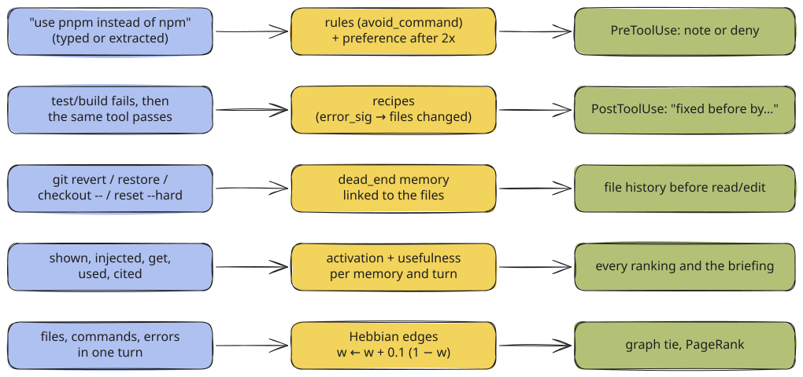

# Learning & Ranking

What agent-mem learns without a model call, how each signal is stored, and how it moves a memory up or down.

Facts need a model (the [observer](observer-pipeline.md)). Everything on this page needs none. It is
counted from what the hooks see, in plain SQL, on the hook path or in the daily consolidation.



<sub>[Excalidraw scene](../../assets/diagrams/learning-loops.excalidraw)</sub>

## Activation (ACT-R)

Memories used often and recently rank higher. Unused ones fade, but nothing is deleted for being old.

```text
B = ln Σ_j  max(t_j, 1) ^ -0.5          t_j = hours since retrieval j (the newest 20 exactly,
                                          older ones approximated with the age of the oldest of those 20)
activation_factor = 0.5 + 0.5 · σ(B)     σ = logistic function; a memory never retrieved gets B = -10 → 0.5
```

What counts as a retrieval: `created`, `get`, `used`, `cited`. What does **not**: `shown` and `injected`. An
injection is an exposure. Counted as a retrieval, it would raise the activation of whatever was injected and
make it injected again, so the briefing would feed itself.

| Hours since one retrieval | t^-0.5 | B | factor |
| --- | --- | --- | --- |
| ≤ 1 | 1.00 | 0.00 | 0.75 |
| 24 | 0.20 | −1.59 | 0.58 |
| 168 (a week) | 0.077 | −2.56 | 0.54 |
| five retrievals within the last hour | 5.00 | 1.61 | 0.92 |

## Usefulness (implicit feedback)

```text
usefulness        = (used + 1) / (shown + 2)        Laplace-smoothed, neutral 0.5
usefulness_factor = 0.5 + usefulness                 0.5 … 1.5, used in every search score
briefing_factor   = 0.5 + (used + 1) / (injected + 2) used for the session-start briefing
```

A memory counts as **used** when the agent:

| Signal | Access kind | Recorded by |
| --- | --- | --- |
| opens it with `mem_get` | `get` | `memory/views.details` |
| edits a file the memory is linked to, after it was shown or injected this session | `used` | `capture._feedback_used` |
| writes its id (`T12`, `M3`) in the final answer | `cited` | `capture._on_stop` |

A memory injected at many session starts and never used makes room for something else (`briefing_factor` falls
toward 0.5). One shown for every prompt and never opened sinks in search.

> [!NOTE]
> The access log is the table `accesses(owner_type, owner_id, ts, kind, session_id)` with kinds `created`, `shown`,
> `injected`, `get`, `used`, `cited`, `warned`. Exposure rows (`shown`, `warned`, `injected`) older than
> `retention.access_days` (180) are removed by the indexer; `created`, `get`, `used` and `cited` feed activation and
> stay.

## Importance and trust

`importance` (0–1) is set when a row is written and only goes up:

| Event | Importance |
| --- | --- |
| a read | 0.1 |
| a command | 0.3 |
| an edit, a test | 0.5 |
| an error, a long answer (over 200 characters) | 0.6 |
| a decision, a dead end, a commit | 0.7 |
| a correction | 0.8 |
| a lesson | 0.8 |
| an extracted rule (preference) | 0.85 |
| a fix (a failing command passed again) | 0.9 |
| a preference stated in two projects (global) | 0.9 |

In a score it counts as `0.7 + 0.3 · importance`, so it never dominates.

`trust` says who wrote the text: `user` (1.0, what you typed), `agent` (0.9, `mem_remember`, imported notes),
`observer` (0.8, extracted facts), `tool_local` (0.8), `tool_external` (0.5, web pages, third-party MCP servers),
`raw` (0.8, a turn kept word for word).

## Corrections become rules

```text
you type:   "Use pnpm instead of npm"
            → rules(kind='avoid_command', pattern='npm', message='Use `pnpm` instead of `npm`', evidence=1, enabled=0)
again:      evidence = 2  = rules.min_corrections
            → memories(kind='preference', title='Use `pnpm` instead of `npm` (corrected 2x)', trust='user', importance 0.85)
            → with rules.auto_enable: enabled = 1
```

| Rule state | Before `npm install` |
| --- | --- |
| suggested (`enabled = 0`, default) | a note: `- Note (R1): earlier correction — Use pnpm instead of npm (1x).` |
| enabled (`agent-mem rules enable 1` or `rules.auto_enable`) | the call is **denied**: `agent-mem rule R1: Use pnpm instead of npm (you were corrected 2x).` |

The statements agent-mem recognizes in a prompt you typed:

| Pattern | Example | Rule |
| --- | --- | --- |
| `use / nutze / verwende / benutze / nimm X instead of / statt / anstatt / anstelle von / not Y` | `use pnpm instead of npm` | avoid `npm`, prefer `pnpm` |
| `X statt / anstatt Y` (short, or with backticks) | `` `uv` statt `pip` `` \| avoid `pip`, prefer `uv` |
| `nicht / kein / not / no X [benutzen], sondern / but / use Y` | `nicht pip benutzen, sondern uv` | avoid `pip`, prefer `uv` |
| `never use / don't use / do not use / nie / niemals / kein / keine / nicht X` | `never use yarn` | avoid `yarn` (no preferred tool) |

A bare `X statt Y` inside a long sentence without backticks is ignored: "Redo anstatt Reuse zu nennen" is a word
swap, not a tool rule.

Rules for counting:

- **One turn is one statement.** The prompt hook and later the observer read the same prompt; counted twice, a
  sentence typed once would become a preference. The key `rule.turn|<project>|<avoid>|<prefer>|<turn>` in `meta`
  makes each count unique.
- **The newer statement wins.** "Use npm instead of pnpm" after "use pnpm instead of npm" disables the old rule
  and retires its preference; with both on, npm and pnpm would both be blocked.
- **Only your words.** A rule extracted by the observer is created only if both tool names appear in what you
  typed, not just in a README the agent read.
- **A rule matches programs, not substrings.** The command is split at `&&`, `||`, `;` and `|`, redirects and
  leading `VAR=value` assignments are removed, and the rule's pattern is compared with the programs that run.
- **Overrides.** Typing `trotzdem`, `egal`, `anyway`, `do it anyway`, `ignore the rule` or `mach es trotzdem`
  within 15 minutes after a rule fired counts as an override; the second override switches the rule off.
- **Expiry.** An enabled rule that has not fired for `rules.expire_days` (90) is switched off by the daily
  consolidation.

Manage rules with `agent-mem rules list|enable|disable|delete <id>`.

## Errors become recipes

When a **test, build, lint or install** command fails and the same tool later passes in the session, agent-mem
records an error-to-fix recipe:

| Column | Example |
| --- | --- |
| `error_sig` | hash of the normalized error (paths, numbers, hex ids, quoted names removed) |
| `error_text` | `E   ImportError: cannot import name 'subtract' from 'calc' (calc.py)` |
| `command_key` | `uv run pytest` |
| `files_json` | `["calc.py"]`, the files edited between the failure and the pass |
| `successes`, `recurrences` | how often it was fixed, how often it came back |

The next failure with the same signature gets `This error was seen before with uv run pytest and fixed by changing
calc.py (see T1). Seen 1x, fixed 1x.` A failed `cat`, `grep` or `ls` is looking around and never makes a recipe; a
non-zero exit without an error line (grep with no match) is not an error that was fixed. The daily consolidation
drops recipes that slipped through from older releases.

## Reverts become dead ends

A successful `git revert`, `git restore`, `git checkout -- <file>` or `git reset --hard` turns the session's
reverted edits into a `dead_end` memory linked to those files:

```text
Changes to calc.py were reverted (`git checkout`) — context: Make subtract accept strings
```

Before the next read or edit of `calc.py` in any session, the file history shows it first, labelled `Caution`.

## The association graph

Every finished turn links its files, the working part of its commands (`uv run pytest`, not the whole line),
its error lines and error signatures as **entities**. Entities of one turn are connected pairwise with a
Hebbian update:

```text
w ← w + 0.1 · (1 − w)          per co-occurrence, at most 12 entities (66 pairs) per turn
w ← w · 0.5 ^ (days / 60)      decay in the daily consolidation; edges under 0.05 are removed
```

At search time, entities named in the query seed a **Personalized PageRank** (restart probability 0.5,
30 iterations) over the project's edges; the top 30 nodes and the seeds weight the memories and turns linked to
them. Frequent "hub" entities (a test command in every turn) are damped like IDF:
`weight / (1 + ln(1 + degree))`, and only their 50 newest links are read. The graph **reorders** hits that text and
vectors found (`× (1 + 0.3 · tie)`); it adds no candidates of its own.

Separately, the observer reads memories into a typed graph of concepts and relations ("search.py uses SQLite
FTS5") that the viewer draws. See [Observer Pipeline](observer-pipeline.md#graph).

## Daily consolidation

The indexer runs this at most once per 24 hours (`meta.consolidated_at`):

| Step | What |
| --- | --- |
| 1 | decay and prune Hebbian edges |
| 2 | a preference you stated in **two or more projects** becomes a global preference `(across projects)`, importance 0.9; it is withdrawn when the projects take it back |
| 3 | of facts, decisions and summaries with the same normalized title in a project, the newest wins |
| 4 | enabled rules unused for `rules.expire_days` are switched off |
| 5 | recorded commands keep only their reusable part (`… 2>&1 \| tail; git status` → `uv run pytest -q`) |
| 6 | recipes whose "error" is no error are dropped |
| 7 | entities that are whole command lines or scratch files are merged into their working part or removed |
| 8 | git blob hashes are recorded for linked files (anchors) |
| 9 | a dead end or decision whose every anchored file was **deleted** is retired |
| 10 | with vectors: new memories add `related: <title>` as a search key to up to four neighbours with cosine ≥ 0.85 in the same project |

The vector side also retires an older observer or agent memory when a newer one of the same project says the same
thing (cosine ≥ `semantic.duplicate_min_cosine`, 0.90). What you wrote is never retired this way.

## Where it all meets

```text
search score = rrf_norm × activation_factor × (0.7 + 0.3 · importance) × usefulness_factor × trust × project_boost
briefing     = activation_factor × briefing_factor × (0.7 + 0.3 · importance) × kind priority
               kind priority: preference 1.3 · dead_end 1.25 · decision 1.2 · correction 1.1 · lesson 1.1 · other 1.0
```

See [Search Architecture](search.md) and [Context Injection](context-injection.md).

---

← [Context Injection](context-injection.md) · [Contents](../../README.md#contents) · [Capture & Privacy](capture-and-privacy.md) →
