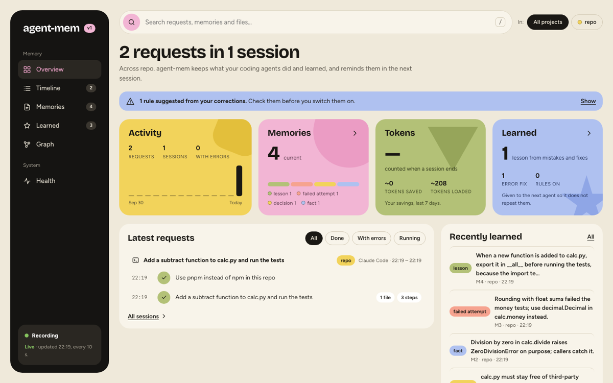
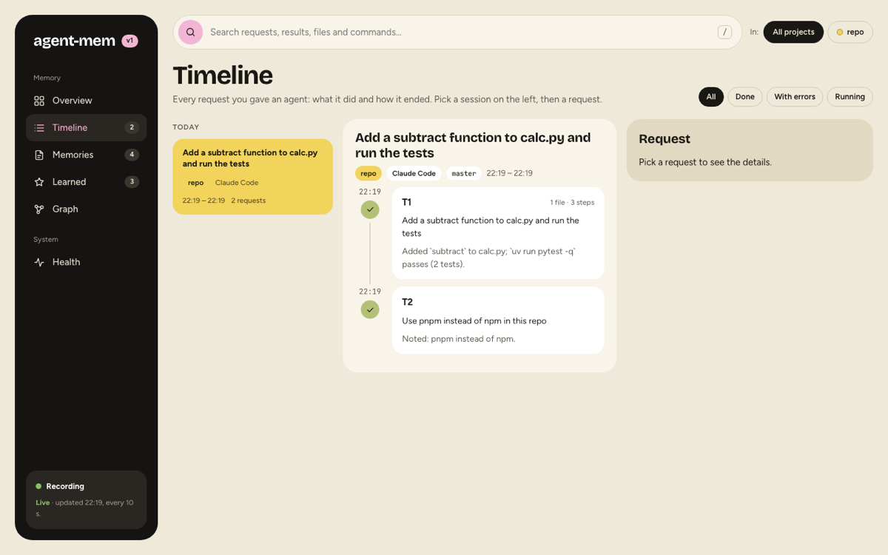
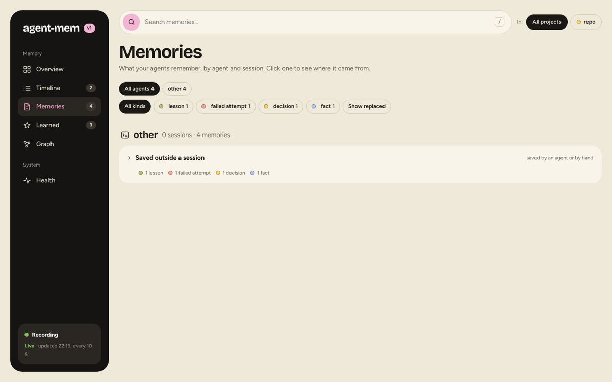
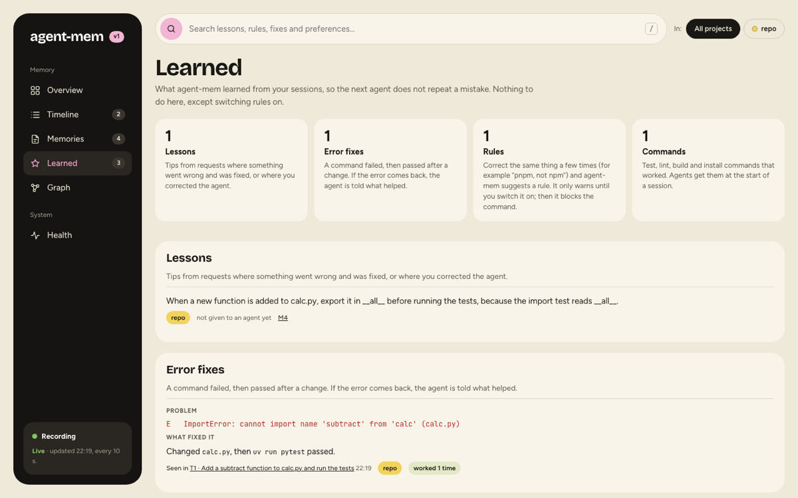
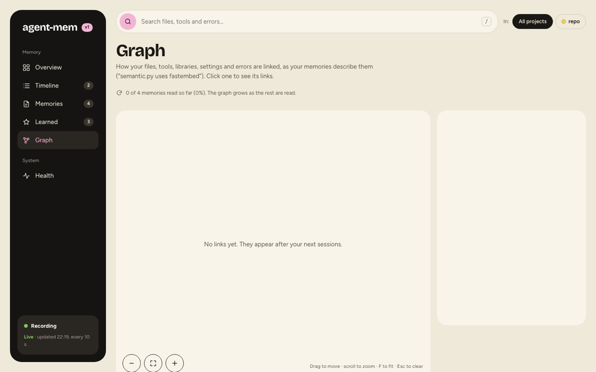
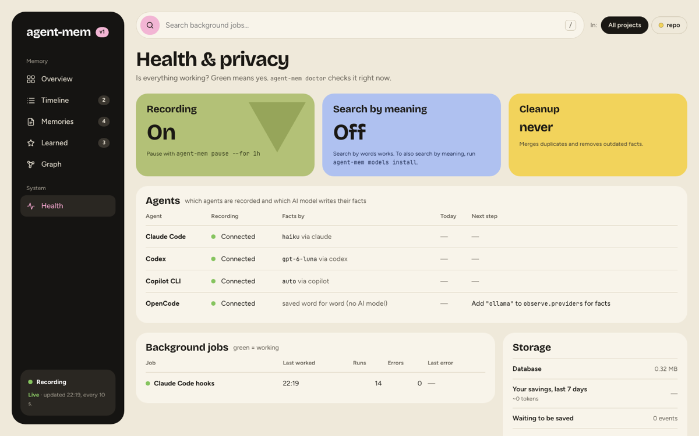

# Viewer

The local page at localhost:37778. What each view shows and how to use it.

Open **http://localhost:37778** or run `agent-mem view`. The viewer runs in the background, starts with every
agent session and at login, and reads the same database the agents use. It is read-only. Nothing you do there
changes your memory, except that you can switch rules on from the terminal it tells you about.

The page is built fresh when the database changes. An open tab reloads itself every 10 seconds
(`viewer.refresh_seconds`). The pills at the top switch between all projects and one project. `/` focuses search.

## Overview



How much is saved across how many projects, activity per day, memories by kind, the token comparison (what
loading cost against what finding it out took) and what was learned. Below, the latest requests with their steps
and the memories learned most recently. Filters: all requests, done, with errors, running.

## Timeline



Every session under its title, with the observer's summary (done, learned, next steps) and its requests. A request
opens to each step: the agent's own description of the tool call, the command or file, and whether it failed. Failed
commands stand out. Sessions without requests are counted below the list, not shown.

## Memories



Sorted by agent, then by session, preferences and lessons first. The agents' own notes (Claude Code's memory files,
Codex's summaries) get a group of their own. A memory opens to its full text, provenance (which request it came
from), trust, links to files and their state, and `Savings`: what it cost to learn against what it costs to read.
Retired memories can be shown with a toggle; they say what replaced them.

## Learned



What agent-mem learned so the next agent does not repeat a mistake:

| Section | What |
| --- | --- |
| Lessons | rules for next time, drawn from a mistake and its fix, a correction or a reverted approach |
| Error fixes | a command failed, then passed after a change: the problem, what fixed it, where it was seen, how often it worked |
| Rules | your repeated corrections; they warn until you switch them on with `agent-mem rules enable R1`, then they block |
| Commands | test, lint, build and install commands that worked; agents get them at session start |

## Graph



How the files, functions, tools, libraries, settings and errors of a project relate ("search.py uses SQLite
FTS5"), read from the memories by the background model. Click a thing to see each relation and the memory it comes
from. The graph fills over several observer runs (three batches of 40 memories per run).

## Health



Whether everything works: recording on or paused, search by meaning, the last cleanup; per agent whether it is
connected, which model writes its facts, and the next step if something is missing; each background job with its
last run, runs and errors; storage, savings and events waiting to be saved. `agent-mem doctor` checks the same in a
terminal.

## Offline snapshot

```sh
agent-mem view --output memory.html
```

Writes the same page as one local file with a copy of your memory. It makes no network requests. Useful on a
machine where the viewer is off. `agent-mem purge` discards an existing snapshot.

## Turning it off, moving it

| Want | Do |
| --- | --- |
| another port | `"viewer": {"port": 37800}` in `config.json` |
| no viewer at all | `"viewer": {"enabled": false}` |
| no login item | `agent-mem serve --no-autostart` |
| start at login again | `agent-mem serve --autostart` |

> [!WARNING]
> The viewer has no login. It listens on 127.0.0.1 only and refuses requests for any other host name, but anyone with
> an account on this machine can open it. Turn it off on shared machines.

---

← [Search & MCP tools](search-and-mcp.md) · [Contents](../../README.md#contents) · [Rules & lessons](rules-and-lessons.md) →
